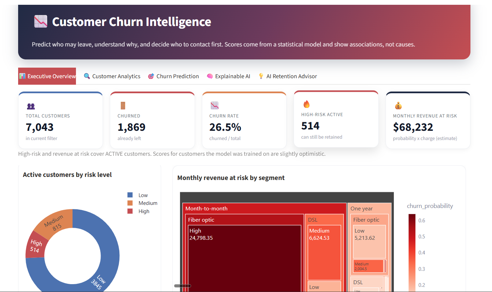
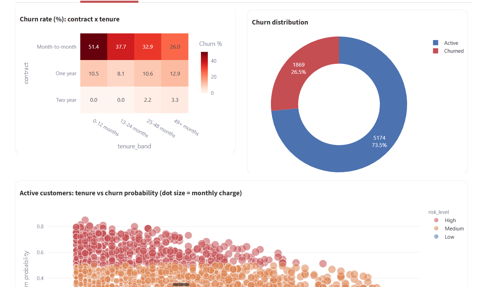
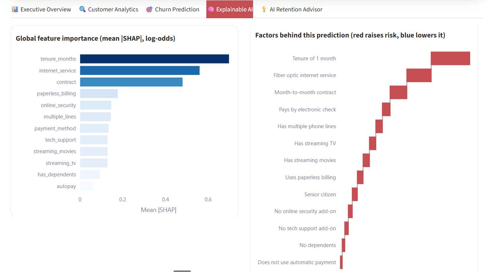
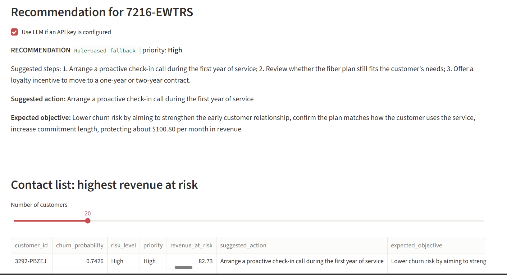
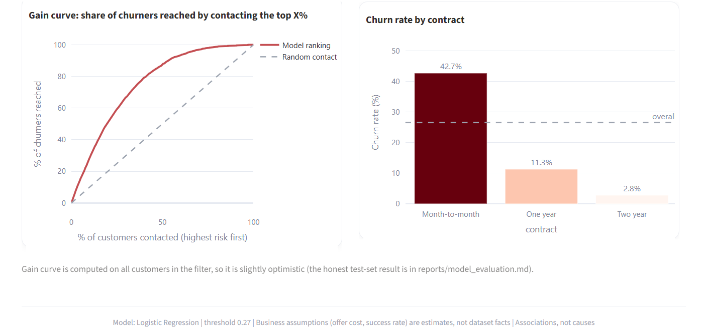

# AI-Powered Customer Churn Intelligence System

**Live demo:** https://customer-churn-ai-analytics.streamlit.app/

An end-to-end project that predicts which telecom customers are likely to leave, explains why, and turns the predictions into a prioritised retention contact list. It covers SQL, exploratory analysis, machine learning, explainable AI (SHAP), retention recommendations and an interactive Streamlit dashboard.



## Business problem

Knowing that customers churn is not enough. The business needs to know:

- Which segments churn most
- What drives churn in the model
- Which customers to contact first
- Which retention actions to prioritise
- How much revenue is at risk

This project answers those questions with data, and is explicit about what the data cannot tell us.

## Key results

All figures come from the IBM Telco Customer Churn dataset (7,043 customers, 1,869 churned, 26.5% churn rate).

**Findings from SQL and EDA**

| Finding | Value |
|---|---|
| Churn, month-to-month vs two-year contract | 42.7% vs 2.8% |
| Month-to-month customers | 55% of customers, 89% of churners |
| Churn in first 12 months vs after 4 years | 47.4% vs 9.5% |
| Churn, fiber optic vs DSL | 41.9% vs 19.0% |
| Churn, electronic check vs other payment methods | 45.3% vs 15% to 19% |
| Internet customers without vs with tech support | 41.6% vs 15.2% |
| Share of monthly revenue held by churned customers | 30.5% (higher than the 26.5% churn rate) |

**Model (held-out test set, 1,409 customers, evaluated once)**

| Metric | Value |
|---|---|
| Selected model | Logistic Regression (chosen on training data) |
| ROC-AUC / PR-AUC | 0.840 / 0.631 |
| Decision threshold | 0.27 (chosen on out-of-fold training data by estimated net benefit) |
| Recall / precision at that threshold | 0.778 / 0.514 |
| Calibration | 377 expected vs 374 actual churners |

**Estimated campaign value on the test set** (depends on the business assumptions below)

| Strategy | Net benefit |
|---|---|
| Contact nobody | $0 |
| Contact everyone | $11,195 |
| SQL rule baseline (month-to-month, 12 months or less, electronic check) | $14,818 |
| **Logistic Regression at threshold 0.27** | **$38,221** |

### Business assumptions (not from the dataset)

The dataset has no campaign data, so these are editable assumptions in `src/config.py`: offer cost $50, offer success rate 25%, and a saved customer is worth 12 months of their monthly charge. Net benefit figures change with them.

> The demo runs on Streamlit Community Cloud. If it has been idle it may be asleep: click "Yes, get this app back up" and wait a few seconds.

## Screenshots

| | |
|---|---|
|  |  |
| Customer analytics | Explainable AI (SHAP) |
|  |  |
| Retention advisor | Gain curve |

## Architecture

```
Raw CSV -> SQLite (SQL cleaning and analysis) -> Python features -> Model pipeline
        -> Saved model + threshold -> Scores + SHAP -> Recommendations -> Streamlit dashboard
```

Training code (`model_tuning.py`) and inference code (`prediction.py`) are separate. The dashboard only reads saved files. See [docs/architecture.md](docs/architecture.md).

## Project structure

```
customer-churn-intelligence/
├── data/raw/              original dataset (never edited)
├── data/processed/        scored customers and SHAP values
├── sql/                   table creation, cleaning, business queries, segmentation
├── notebooks/             EDA notebook
├── src/                   config, preprocessing, features, training, tuning, evaluation,
│                          prediction, explainability, recommendations
├── models/                saved pipeline, metadata, tuning results
├── reports/               model evaluation, executive summary, figures
├── dashboard/             Streamlit app, data loader, charts
├── tests/                 pytest unit and integration tests
└── docs/                  architecture and screenshots
```

## Setup

Requires Python 3.12 (3.10 to 3.12 should also work).

```powershell
git clone <your-repo-url>
cd customer-churn-intelligence
python -m venv venv
.\venv\Scripts\Activate.ps1          # macOS/Linux: source venv/bin/activate
python -m pip install -r requirements.txt
```

## Run the pipeline

Run from the project root, in this order:

```powershell
python -m src.db_setup               # build and validate the SQLite database
python -m src.run_queries 03_business_queries.sql
python -m src.model_training         # compare baseline models (cross-validation, training data only)
python -m src.model_tuning           # tune, choose model and threshold (several minutes)
python -m src.model_evaluation       # evaluate once on the test set, write the report
python -m src.explainability         # SHAP values, scored customers, figures
python -m src.ai_recommendations     # retention recommendations (works without an API key)
python -m pytest -q                  # 36 tests
python -m streamlit run dashboard/app.py
```

The EDA lives in `notebooks/01_eda.py` (VS Code cells) and `notebooks/01_eda.ipynb`.

## Retention recommendations and the optional LLM

Recommendations are built only from a customer's real data and their SHAP drivers. An action appears only if the model flags the driver as raising that customer's risk **and** the customer's data matches (for example, a contract incentive only for a month-to-month customer).

- **Default:** a rule-based engine. No API key, no internet.
- **Optional:** set `ANTHROPIC_API_KEY` in a `.env` file (copy `.env.example`) and install `anthropic`. The LLM receives the same facts and is told not to invent anything. On any failure the rule-based engine takes over.
- Every output is labelled: `MODEL PREDICTION` is separate from `RECOMMENDATION [source]`.

API keys are read from environment variables and never stored in code. `.env` is git-ignored.

## Design decisions worth knowing

- **No leakage.** Preprocessing lives inside a scikit-learn `Pipeline`; the test set is untouched until final evaluation; the decision threshold is chosen on out-of-fold training predictions.
- **Collinear features removed.** `monthly_charges` and `total_charges` were dropped from the model after SHAP showed misleading coefficients (they duplicate internet type, add-ons and tenure). Performance did not change (test ROC-AUC 0.841 to 0.840). `monthly_charges` is still used for revenue-at-risk and business metrics.
- **No class weights.** Probabilities stay calibrated, which matters because revenue at risk is probability times monthly charge. The threshold handles the imbalance instead.
- **Simplest model wins ties.** Logistic Regression was chosen because its net benefit was within 2% of the best model, and it is the easiest to explain.

## Limitations

- The data shows associations, not causes. SHAP explains what the model does, not why customers leave.
- The dataset is a snapshot. It has no usage logs, complaints or price-change history, so recommendations cannot reference them.
- Offer cost, success rate and value horizon are assumptions.
- Scores and revenue at risk on the dashboard are in-sample for the 80% of customers the model trained on, so they are slightly optimistic. The honest numbers are the test-set results above and in `reports/model_evaluation.md`.
- The test set has 1,409 customers, so metrics carry roughly +/- 0.02 of sampling noise.

## Future improvements

- Time-based data and survival analysis (when customers churn, not only whether)
- Uplift modelling to find customers who respond to an offer, not just those likely to leave
- A/B test of retention actions to measure the real success rate
- Probability calibration and cost-sensitive threshold search on real campaign costs
- Model monitoring for drift and scheduled retraining
- FastAPI service for real-time scoring, and a PostgreSQL version of the SQL layer
- Dark theme and role-based views for the dashboard

## Data and credits

IBM Telco Customer Churn sample dataset (publicly available, for example on Kaggle). This is a learning and portfolio project, not production advice.